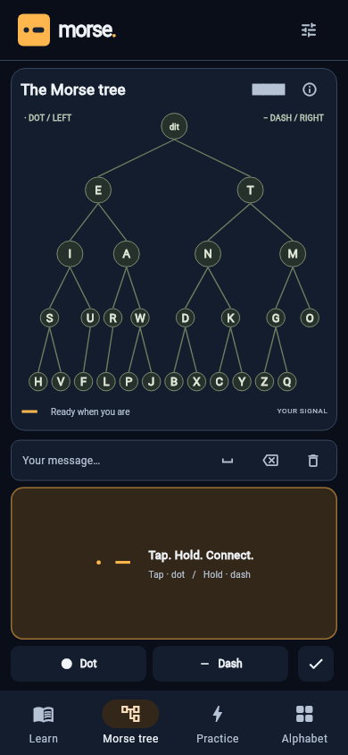
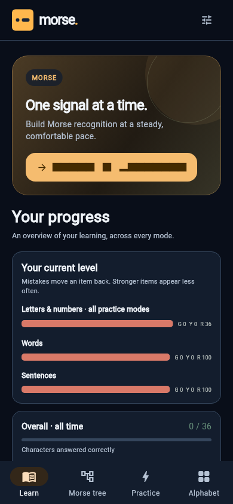
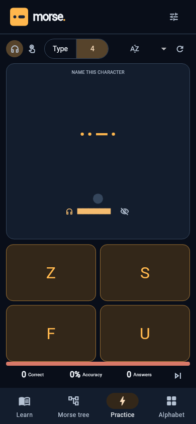
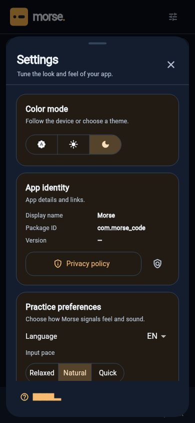

# morse

Learn Morse code one signal at a time. **morse** is a small Flutter app for
Android and the web, with an interactive Morse tree and focused listening and
sending practice.

## Screenshots

| Morse tree · dark | Practice · dark |
| --- | --- |
|  |  |

| Learn · dark | Listening · four choices · dark |
| --- | --- |
|  |  |

### Settings · dark



## Learn and practise

- Explore the complete Morse tree and practise dots, dashes, and letter entry.
- Use Listening or Sending, then choose typed answers or four-choice questions.
- Practise the alphabet, numbers, all 36 supported symbols, 100 real words, or
  100 short sentences. Sending works through a phrase one character at a time;
  Listening presents the whole phrase.
- Take the 20-question Exam. It covers all four practice variants; three
  mistakes end the exam.
- Track practice progress, adjust sound and vibration, and choose a theme in
  Settings.

On phones and tablets, the tree and touch key fit the screen in portrait and
landscape. Settings and progress stay on the device. Android works offline;
web audio and vibration depend on browser support. The app needs no account or
backend.

## Build and verify

```sh
flutter pub get
flutter analyze
flutter test
flutter build apk --release
flutter build web --release --no-web-resources-cdn
```

The Android application ID is `com.morse_code`. Its version name comes from
`pubspec.yaml` (currently `1.8.1`); Android versionCode is `59`. Build both
Android release formats with:

```sh
flutter build apk --release
flutter build appbundle --release
```

For Play Store submission, create a private upload keystore and save its
credentials in the ignored `android/key.properties` file. Use these property
names: `storePassword`, `keyPassword`, `keyAlias`, and `storeFile` (the keystore
path, relative to `android/app`). Release builds use that key when the file is
present; without it they use the debug key and are only for local installation.
Keep the keystore and passwords backed up securely. Store updates need the same
application ID and upload key, plus a higher build number.

To install a release over an earlier locally built APK signed with Android's
debug key, use:

```sh
ORG_GRADLE_PROJECT_localInstall=true flutter build apk --release
```

This local-install build keeps the same signing key as earlier sideloaded
builds. Store builds continue to use the upload key.

Additional signal checks:

```sh
node tests/web_pattern_test.mjs
python3 tools/verify_signal_pattern.py
```

The first checks web playback timing. The second uses the cached Kotlin
compiler to check Android audio and vibration generation and export a waveform
preview.

## App icon

The amber dot-and-dash icon is generated from
[`assets/branding/app-icon.svg`](assets/branding/app-icon.svg). Android includes
legacy, adaptive, and themed icons; the web app includes standard and maskable
icons plus a favicon.

Regenerate icon assets with `python3 tools/generate_icons.py`. Check generated
assets and resource references with `python3 tools/generate_icons.py --check`.

There is no deployment target saved for this project.

## Shared template icons

The common toolbar and Settings icons use `TemplateIcons` from
`lib/template_icons.dart`, mapped to the same built-in Material glyphs used by
Template. A small licensed Material Icons subset is also retained at
`assets/icons/template-material-icons.ttf` for derived app surfaces. It permits
commercial use under CC BY 4.0; the license and attribution are in
`assets/icons/MaterialIcons_LICENSE.txt` and `THIRD_PARTY_NOTICES.md`.
