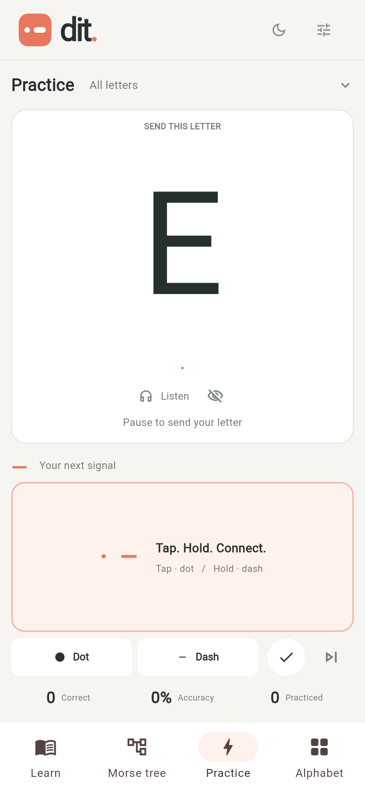
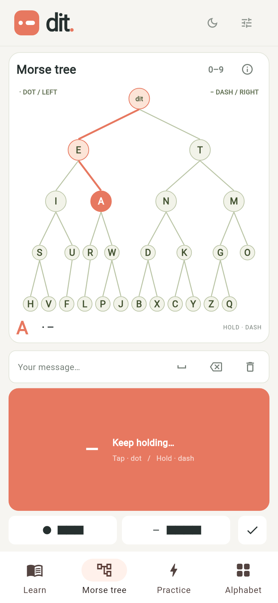
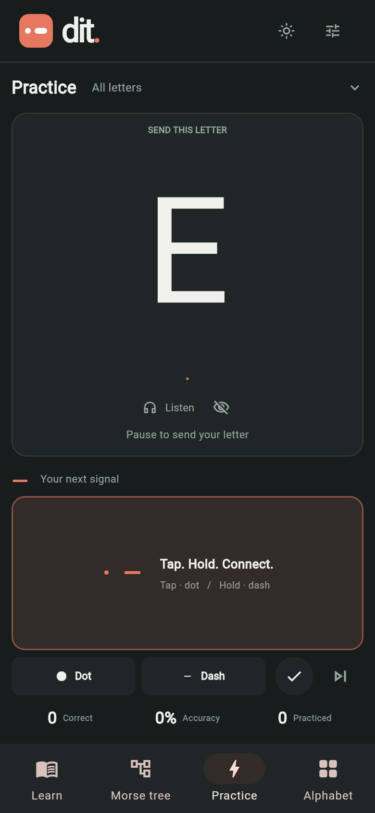
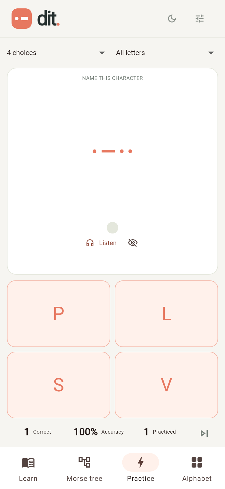

# morse

Learn Morse code one signal at a time. **morse** is a small Flutter app for
Android and the web, with an interactive Morse tree and focused listening and
sending practice.

## Screenshots

| Practice · light | Morse tree |
| --- | --- |
|  |  |

| Practice · dark | Listening · four choices |
| --- | --- |
|  |  |

## Learn and practise

- Explore the complete Morse tree and practise dots, dashes, and letter entry.
- Use Listening or Sending, then choose typed answers or four-choice questions.
- Practise the alphabet, numbers, all 36 supported symbols, 100 real words, or
  100 short sentences. Sending works through a phrase one character at a time;
  Listening presents the whole phrase.
- Take the 20-question Exam. It covers all four practice variants; three
  mistakes end the exam.
- Track practice progress, adjust sound and vibration, and switch themes.

On phones and tablets, the tree and touch key fit the screen in portrait and
landscape. Settings and progress stay on the device. Android works offline;
web audio and vibration depend on browser support. The app needs no account or
backend.

## Build and verify

```sh
flutter pub get
flutter analyze
flutter test
flutter build apk --release
flutter build web --release --no-web-resources-cdn
```

The Android application ID is `studio.dit.dit_morse`. Its version and build
number come from `pubspec.yaml` (currently `1.2.0+21`). Release builds use the
generated Android debug signing key; keep that key to install updates. Store
releases should use a private release key. Updates need the same application
ID and signing key, plus a higher build number.

Additional signal checks:

```sh
node tests/web_pattern_test.mjs
python3 tools/verify_signal_pattern.py
```

The first checks web playback timing. The second uses the cached Kotlin
compiler to check Android audio and vibration generation and export a waveform
preview.

## App icon

The coral dot-and-dash icon is generated from
[`assets/branding/app-icon.svg`](assets/branding/app-icon.svg). Android includes
legacy, adaptive, and themed icons; the web app includes standard and maskable
icons plus a favicon.

Regenerate icon assets with `python3 tools/generate_icons.py`. Check generated
assets and resource references with `python3 tools/generate_icons.py --check`.

There is no deployment target saved for this project.
